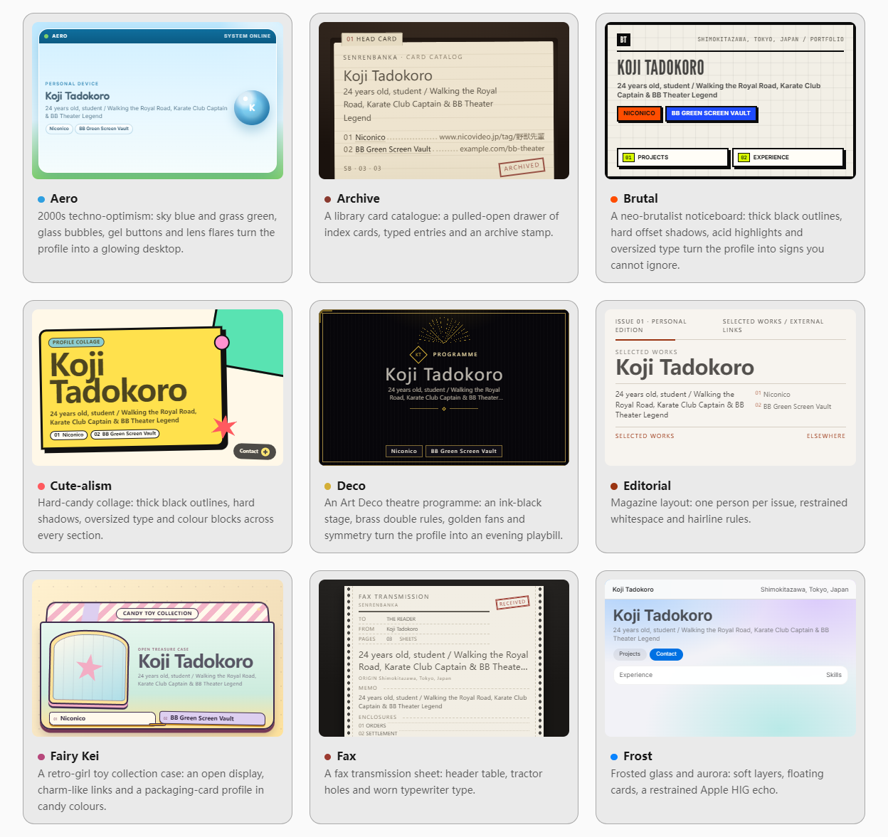
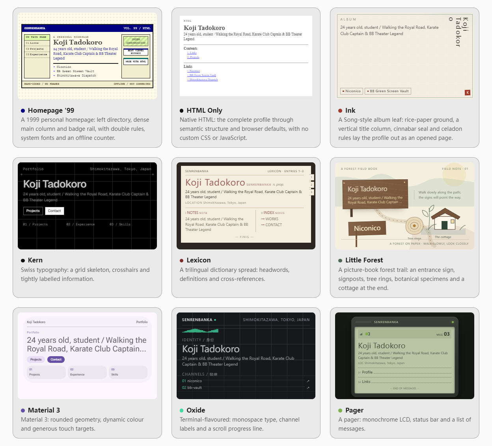
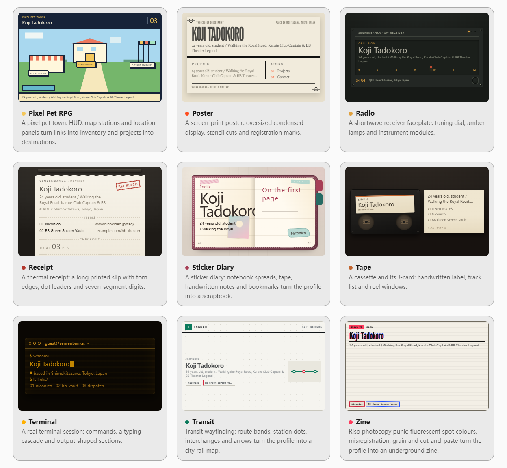

# SenrenBanka

[简体中文](../../README.md) | [繁體中文](README.zh-TW.md) | [日本語](README.ja.md) | English | [한국어](README.ko.md)

> SenrenBanka（「洗練万華」）：一つの**洗練**されたデータから、**万華**鏡のように千変万化するプロフィールサイトを映し出す。

One profile, many complete designs generated by AI from `DESIGN.md`, available in Simplified Chinese / Traditional Chinese / Japanese / English / Korean — built as fully static pages that can be deployed to any static host.

Tech stack: Astro + TypeScript + Tailwind CSS 4

## Features

- 27 visually and structurally distinct designs (26 `styled` + 1 HTML-only with zero CSS / JS), all sharing one profile contract
- **Multilingual (`zh-CN` / `zh-TW` / `ja` / `en` / `ko`)**: each design is a separate static page for every language it **declares coverage for**; profile, copy, and SEO metadata are separated by language; locales not covered by a design do not generate that design page
- **Unified language switching and page actions on `styled` pages**: the desktop context menu and the mobile floating button → bottom action sheet share the same data and semantics (**available on both desktop and mobile**); `html-only` uses native links and does not use this menu
- Random / fixed modes, a random entry with no immediate repeats, and configurable manual switching
- Per-design CSS isolation (Tailwind `source(none)` + `@source`); **multilingual support does not change this**. Fonts are self-hosted at build time, with zero third-party requests at runtime
- The root entry is a client-side route with zero external requests; only each language's default design is indexable (avoiding near-duplicate content)
- Use this repository as a template or fork it: change the profile and `src/data/site.config.yaml`, then deploy to GitHub Pages / Cloudflare Pages / Vercel

## All designs

All 27 designs share one profile. Each image below shows nine designs. After deployment, browse the interactive full list at `/<locale>/designs/`.







## One-click deployment with an agent

Install the `personal-site-launch` skill:

```bash
npx skills add ShiroPrism/SenrenBanka --skill personal-site-launch -g
```

`-g` installs it in the user-level skill directory so it can be used from any project; choose your agent when prompted by the command line. You can also omit `-g` to install it only for the current project.

After installation, you do not need to fork, clone, or create a repository manually. Use the following shortcut prompt to invoke `personal-site-launch` and give the agent your profile material:

```text
/personal-site-launch Create an independent personal-homepage repository from the template https://github.com/ShiroPrism/SenrenBanka and clone it locally. Then use the images, PDFs, DOCX files, Markdown files, and other profile material I provide next to generate profiles, update site.config.yaml, complete build verification, and deploy it to a public URL. If no language is specified, follow the material language and the project's existing languages. If GitHub, Cloudflare, or Vercel access is missing, list the permissions I need to enable and wait; do not ask me to create the repository by hand.
```

GitHub Pages is preferred by default. If you only want Cloudflare Pages Direct Upload or the Vercel CLI, say so directly in the prompt; deployments uploaded from local files do not require a GitHub repository first.

## Quick start

```bash
npm ci
npm run fonts:prepare  # Download and verify fonts.lock.json into .cache/fonts/ and .cache/font-sources/
npm run dev            # http://localhost:4321
npm run build          # eol/lint/format + fonts:check + astro check + build + fonts:subset + fonts:prune + HTML audit
npm run preview
```

Code and configuration use Prettier + ESLint; after adding or modifying files, run `npm run format && npm run lint`. Line endings are fixed to LF by `.gitattributes` / `.editorconfig`, and `npm run check:eol` rejects CRLF before the build.

Font caches are not versioned and are not downloaded implicitly in `postinstall`. A clean clone must explicitly run `npm run fonts:prepare`; once prepared, `fonts:check` in `npm run build` recomputes the hashes of the lock, snapshot, cached files, and generated registry entirely offline. Missing or corrupted caches produce a repair command and fail.

`--font-*` variables expose only the primary face; the six npm families and 31 external local families do not carry Astro fallbacks. Each design's `style.css` maintains its own full stack from “Latin voice → core CJK (Zhuque / LXGW / Ark Pixel / Traditional Chinese TC families) → system Chinese fonts → generic families”; `npm run fonts:typography` statically checks this contract.

`fonts:prepare` also downloads and verifies source archives for the core CJK fonts; at the end of the build, `fonts:subset` generates one WOFF2 glyph subset per family from the final `dist` corpus, and `fonts:prune` then externalizes the remaining `@font-face` declarations into shared font CSS and removes unused shards. The total byte size of every file under `dist` is capped at **10 MiB**. Source fonts, locks, snapshots, and the generated registry stay unchanged; forkers only need `npm run fonts:prepare && npm run build`, with no local fonts, Python, or extra subsetting tools.

The minimum profile needs only the following four core fields. Replace `src/data/profiles/zh-cn.yaml` directly (`ja.yaml` / `en.yaml` work the same way):

```yaml
name: "Your name"
headline: "One-line positioning"
bio: "A 1–3 sentence introduction."
links:
  - label: GitHub
    url: "https://github.com/you"
```

- Change the profile: `src/data/profiles/*.yaml` (one per configured language; currently `zh-cn` / `zh-tw` / `ja` / `en` / `ko`; **all use the same fixed field contract**; core required fields: `name` / `headline` / `bio` / `links`)
- **Required fork change: `src/data/site.config.yaml`** — replacing only the profile keeps the sample person's site title / description and language list:
  - `i18n.locales[].title` / `description`: the SEO title and description for that language;
  - `i18n.locales[].notice`: the sample-data notice; remove this key after entering real profile data;
  - `i18n.locales`: the language list is maintained only here; add or remove a language = change this list + add or remove the corresponding `profiles/<path>.yaml`; `defaultLocale` must be in the list
- Ordinary optional fields: `avatar` (some styles do not show a photo) / `location`
- Advanced optional extension blocks: `projects` / `experience` / `skills` / `contact`. They are retained only for compatibility with existing designs and may be omitted entirely; they are not a custom-content mechanism, and no more fields or blocks of this kind will be added
- Off-site content: point `links` to portfolios, articles, social profiles, and other further information; once content leaves this site, its availability, accessibility, ownership, and persistence are controlled by the external platform
- The complete profiles in this repository (currently five) are design samples used to validate how multiple designs present content; they are not required templates
- Change languages: `i18n.locales` in `src/data/site.config.yaml` (**the language list is maintained in this one place**: add or remove a language = add one `locales` entry + one matching `profiles/<path>.yaml`). To add a language, also append that code to the `locales` array of every design's `design.json` that should cover it; the default design must cover every locale. **Keep only one language**: reduce `i18n.locales` to one entry and delete the extra profiles; codes not configured in `design.json` are ignored, and the language group and native-language area are not rendered at all (the `/<locale>/` prefix remains)
- Packaging scope: `design.exclude` in `src/data/site.config.yaml` (default `[]` = all designs; excluded designs do not build pages / legacy redirects and do not enter the random pool or switcher; `enabled` only applies inside the packaged set). Example: `exclude: [archive]`
- Change behavior: `design` in `src/data/site.config.yaml` (`mode` / `default` / `manualSwitch` / `exclude` / `cacheHours`)
- Change interface copy: shared copy lives in `src/i18n/messages.ts`; each design's own copy lives in `src/designs/<id>/messages.ts` (a missing file or key **fails the build**)
- Add or remove designs: create or delete a directory under `src/designs/<id>/` (the directory's existence registers the design). Required together: `DESIGN.md` / `design.json` / `Page.astro` / `messages.ts`; `renderMode: "styled"` (the default) also requires `style.css`, while `renderMode: "html-only"` forbids `style.css` / `tokens.css` but may provide a self-contained `Preview.astro`. See `SPEC.md` §4–§6 and `docs/rules/` for the process and compliance requirements. Restart `npm run dev` after adding a directory.
- Fonts: manual choices are maintained only in `fonts.config.json`; `fonts.lock.json` / `fonts.catalog.json` / `src/fonts/generated.ts` are generated by `npm run fonts:update` from a pinned external catalog release. The six Fontsource families also read installed `node_modules` files through an in-config wrapper and do not depend on a build-time CDN. Do not edit generated files by hand, and do not commit `.cache/fonts/` or `.cache/font-sources/`. The `npm run fonts:subset` subset report is written to `.cache/fonts/subset-report.json`; the `npm run fonts:prune` deployment shard set and size report are written to `.cache/fonts/prune-report.json`; `npm run fonts:audit` writes its core-CJK missing-glyph and deployment-set report to `.cache/fonts/audit-report.json`.

When upgrading the font catalog, you must explicitly provide the pinned URL and SHA from the release page; “track the latest automatically” is not accepted:

```bash
npm run fonts:update -- \
  --catalog-url https://github.com/whitehair-failure/SenrenBanka-fonts/releases/download/catalog-v1.0.0/catalog.json \
  --catalog-sha256 <release-sha256>
npm run fonts:prepare
npm run fonts:check
```

### URL rules

```
/                         Root entry → negotiate language (preference → browser language → default zh-CN), then enter a random / fixed design
/zh-cn/<design>/  /zh-tw/<design>/  /ja/<design>/  /en/<design>/  /ko/<design>/    Designs declared for each language (authoritative URLs)
/zh-cn/designs/ etc.      Per-language design switcher (not built when manualSwitch is off)
/<design>/  /designs/     Legacy unprefixed paths → static redirects to the default-language version (meta refresh + canonical + noindex)
```

- `/` negotiates the Locale by “manual language preference → browser language → `i18n.defaultLocale`”; the path language in `/<locale>/...` always wins, with no runtime rewrite and no Cookie-based language detection.
- The site has only one `404.html`: at runtime it resolves the display language by “first path segment → language preference → browser language → default Locale”, pre-renders every language block, and switches before first paint; without JavaScript it always displays the default Locale. No separate 404 page is generated for each language.
- The current deployment uses a random entry (`cacheHours: 0`): every visit to `/` or `/<locale>/` draws a design again; `/<locale>/<design>/` is a stable design address, and direct visits, refreshes, bookmarks, and shares do not redraw. To bookmark “a different design each time”, bookmark `/` or `/<locale>/`.
- Without JavaScript, `/` still uses `meta refresh` to enter the default Locale's default design and design list; browser-language negotiation is unavailable, which is a known limitation of this fallback path.
- When deployed under a subpath (such as a GitHub Pages `/<repo>/`), all links, CSS, fonts, `canonical`, and `hreflang` automatically include the base prefix.
- Legacy paths are **not** real HTTP 301s (a static-hosting limitation); they are explicitly declared fallbacks: static meta refresh + `canonical` + `noindex, follow`. For real 301s, configure redirects on the hosting platform.

### Language switching

On `styled` pages, language switching is a group inside the **shared action menu**; `html-only` pages list ordinary language links directly in the body navigation. In both modes, switching language **keeps the current page context** — a theme page keeps the current design, the switcher keeps the switcher, and a 404 returns to the corresponding language's entry.

- Desktop mouse environment: right-click or press `Shift+F10` to open the menu; language items are collected in a submenu.
- Mobile: the **floating button** in the lower-right opens the **bottom action sheet**, where language items are laid out directly (touch has no hover-submenu mental model).
- The two points above apply to `styled` pages; ordinary language links on `html-only` pages do not depend on the input environment.
- Theme preference (`localStorage`) is shared across languages: switching language on a `styled` page **does not** reset the design storage; with the current zero-window random mode, the next entry still redraws.
- Explicitly clicking a language link in the shared action menu remembers the entry language preference; opening a design page in a certain language directly does not overwrite an existing preference. `html-only` pages have no runtime, so clicking a language only completes that navigation and does not persist a preference.
- The 404 display language only reads the language preference and is never written automatically because of a bad path; the shared menu's current-language marker, copy, and random target follow the 404 display language.
- Without JavaScript, the language entry on `styled` design pages is unreachable (the shared menu depends on runtime); the switcher and 404 provide `<noscript>` language links as a fallback, and `html-only` design pages use native language links that are always visible.

### Page actions

The same menu on `styled` pages also offers reload, back to top, copy link, print / save as PDF, share page, and random design switching. `html-only` pages do not provide these menu actions and keep only ordinary link navigation.

- “Random design” on a theme page excludes the current design; the switcher and 404 have no “current design” and draw from all themes.
- Menu styling is project chrome with a neutral appearance and does not imitate any theme's visual language (see `docs/rules/action-menu.md` and ADR 0007).

## Deployment

### GitHub Pages (zero configuration for templates / forks)

1. Repository Settings → Pages → Source → choose **GitHub Actions**
2. Pushing to `main` builds and deploys automatically; the workflow reuses `.cache/fonts/` by the `fonts.lock.json` hash, then runs `npm run fonts:prepare`; `SITE_URL` / `BASE_PATH` are injected automatically from the repository context
3. Custom domain: change `BASE_PATH` to `/` in the workflow and place a `CNAME` file in `public/`

### Cloudflare Pages

- Connect the repository; Build command `npm ci && npm run fonts:prepare && npm run build`; Build output directory `dist`
- Optional environment variable: `SITE_URL=https://<your-domain>` (used for absolute canonical URLs)
- The build environment uses Node.js 24 (the project's `.nvmrc`); only `fonts:prepare` accesses the network when the cache is missing, and the later build does not contact font sources.

### Vercel

- Import the repository; the framework preset automatically detects Astro; Install Command `npm ci`; Build Command `npm run fonts:prepare && npm run build`; optional environment variable `SITE_URL`
- Node.js version 24 is used (the project's `.nvmrc`); the binaries of the 20 local-provider families are not committed to Git and are prepared from the pinned font catalog release at deployment time.

## Design sources and licenses

- This repository's code: MIT (see `LICENSE`)
- Oxide design specification: from [oxidecomputer/design-system](https://github.com/oxidecomputer/design-system) (MPL-2.0)
- Material 3 design specification: from [m3.material.io](https://m3.material.io/) and [material-components/material-web](https://github.com/material-components/material-web) (CC BY 4.0 / Apache-2.0)
- Complete licenses and attribution for each official source are in the corresponding design directory's `SOURCE-LICENSE.txt`; source URLs, retrieval dates, and licenses are in `design.json`

## Documentation

- `docs/README.md`: documentation ownership index and maintenance rules (read it before changing documentation)
- `SPEC.md`: project specification and source of truth (decision record, runtime rules, directory structure, acceptance criteria)
- `AGENTS.md`: entry point for coding-agent rules (hard gates + task routing; full text in `docs/rules/`; verification flow in the `design-page-verify` skill)
- `docs/adr/` long-term technical decisions · `docs/designs/<id>/ADAPTATION.md` theme adaptation notes · `docs/verification/` current verification state for each theme and shared mechanism · `change-log/` version history
