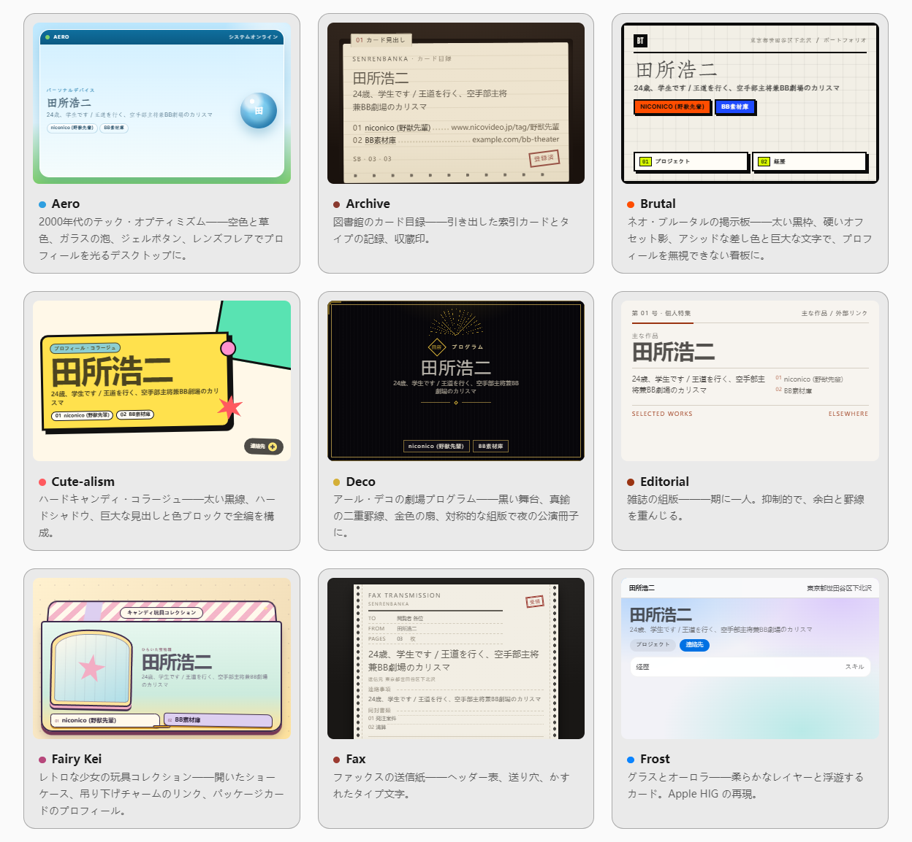
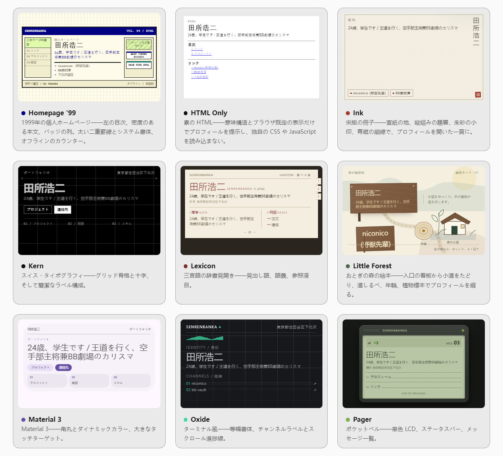
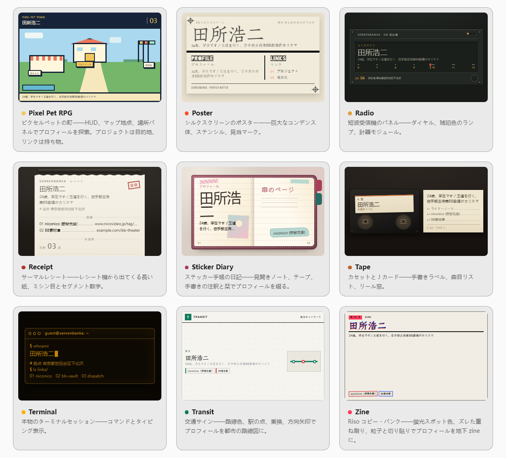

# SenrenBanka

[简体中文](../../README.md) | [繁體中文](README.zh-TW.md) | 日本語 | [English](README.en.md) | [한국어](README.ko.md)

> SenrenBanka（「洗練万華」）：一つの**洗練**されたデータから、**万華**鏡のように千変万化するプロフィールサイトを映し出す。

1 つのプロフィールから、AI が `DESIGN.md` に基づいて生成した複数の完成デザイン。簡体字中国語 / 繁体字中国語 / 日本語 / 英語 / 韓国語に対応し、ビルド時に完全な静的ページを生成して、任意の静的ホスティングにデプロイできます。

技術スタック：Astro + TypeScript + Tailwind CSS 4

## 特徴

- 視覚・構造の異なる 27 デザイン（26 の `styled` + CSS / JS ゼロの HTML-only 1 つ）が、同じプロフィール契約を共有
- **多言語対応（現在 `zh-CN` / `zh-TW` / `ja` / `en` / `ko`）**：各デザインは、**対応を宣言した**各言語で独立した静的ページになります。プロフィール、文言、SEO メタデータは言語ごとに分離され、対応していない locale ではそのデザインページを生成しません
- **`styled` ページの言語切り替えとページ操作の入口を統一**：デスクトップのコンテキストメニュー、モバイルのフローティングボタン → ボトムアクションシートは、同じデータとセマンティクスを共有します（**デスクトップとモバイルの両方で利用可能**）。`html-only` はネイティブリンクを使い、このメニューには接続しません
- ランダム / 固定の 2 モード、入口でのランダム表示と連続重複の回避、手動切り替えの設定
- デザインごとに独立した CSS（Tailwind `source(none)` + `@source` による厳密な分離）。**多言語対応でもこれは変わりません**。フォントはビルド時にセルフホストされ、実行時のサードパーティリクエストはゼロ
- ルートパスは外部リクエストなしのクライアントルーティング。各言語でデフォルトデザインのみインデックス可能（ほぼ重複するコンテンツを回避）
- 本リポジトリをテンプレートまたは fork として使い、プロフィールと `src/data/site.config.yaml` を変更するだけで GitHub Pages / Cloudflare Pages / Vercel にデプロイ可能

## すべてのデザイン

27 デザインは 1 つのプロフィールを共有します。以下の各画像は 9 デザインを示しています。デプロイ後は `/<locale>/designs/` でインタラクティブな一覧を表示できます。







## Agent によるワンクリックデプロイ

`personal-site-launch` skill をインストール

```bash
npx skills add ShiroPrism/SenrenBanka --skill personal-site-launch -g
```

`-g` はユーザーレベルの skill ディレクトリにインストールすることを意味し、以降は任意のプロジェクトで呼び出せます。コマンドラインの案内に従って使用する Agent を選択してください。`-g` を外して現在のプロジェクトだけにインストールすることもできます。

インストール後は、手動で fork、clone、リポジトリ作成を行う必要はありません。次のショートカット Prompt で `personal-site-launch` を呼び出し、プロフィール資料を Agent に渡してください：

```text
/personal-site-launch テンプレートリポジトリ https://github.com/ShiroPrism/SenrenBanka から、私専用の独立した個人ホームページリポジトリを作成してローカルに clone してください。その後、私が続けて提供する画像、PDF、DOCX、Markdown などのプロフィール資料から profiles を生成し、site.config.yaml を同期して、ビルド検証を完了し、アクセス可能な URL にデプロイしてください。言語が指定されていない場合は、資料の言語とプロジェクト既存の言語に従ってください。GitHub、Cloudflare、Vercel の接続 / 権限が不足している場合は、私が有効化すべき項目を直接列挙して待機し、リポジトリを手動で処理させないでください。
```

既定では GitHub Pages を優先します。Cloudflare Pages Direct Upload または Vercel CLI だけを使いたい場合は、Prompt で直接指定してください。ローカルからアップロードするデプロイ方式では、先に GitHub リポジトリを作成する必要はありません。

## クイックスタート

```bash
npm ci
npm run fonts:prepare  # fonts.lock.json に従って .cache/fonts/ と .cache/font-sources/ にダウンロードして検証
npm run dev            # http://localhost:4321
npm run build          # eol/lint/format + fonts:check + astro check + build + fonts:subset + fonts:prune + HTML 監査
npm run preview
```

コードと設定は Prettier + ESLint で統一されています。ファイルを追加・変更したら `npm run format && npm run lint` を実行してください。改行コードは `.gitattributes` / `.editorconfig` で LF に固定され、`npm run check:eol` がビルド前に CRLF を検出して止めます。

フォントキャッシュはバージョン管理に含まれず、`postinstall` で暗黙にネットワーク接続もしません。クリーンな clone では明示的に `npm run fonts:prepare` を実行する必要があります。準備後、`npm run build` の `fonts:check` はロック、スナップショット、キャッシュファイル、生成レジストリのハッシュを完全オフラインで再計算します。キャッシュが欠落・破損している場合は修復コマンドを示して失敗します。

`--font-*` 変数はメインの face だけを公開し、6 つの npm family と 31 の外部 local family はいずれも Astro fallback を伴いません。各デザインの `style.css` は「ラテン声部 → コア CJK（Zhuque / LXGW / Ark Pixel / 繁体字中国語 TC ファミリー）→ システム中国語フォント → 汎用ファミリー」という完全な順序を自身で維持し、`npm run fonts:typography` がこの契約を静的に検査します。

`fonts:prepare` はコア CJK フォントの source archive もダウンロードして検証します。ビルド末尾の `fonts:subset` は最終 `dist` コーパスからファミリーごとに 1 つの WOFF2 字形サブセットを生成し、`fonts:prune` は残りの `@font-face` を共有フォント CSS に外部化して未参照のシャードを削除します。`dist` 内の全ファイルの合計バイト上限は **10 MiB** です。ソースフォント、ロック、スナップショット、生成レジストリは変更されません。fork ユーザーは `npm run fonts:prepare && npm run build` を実行するだけで、ローカルフォント、Python、追加のサブセットツールは不要です。

最小プロフィールは次の 4 つのコアフィールドだけです。`src/data/profiles/zh-cn.yaml` を直接置き換えてください（`ja.yaml` / `en.yaml` も同様です）：

```yaml
name: "あなたの名前"
headline: "一文でのポジショニング"
bio: "1〜3 文の紹介。"
links:
  - label: GitHub
    url: "https://github.com/you"
```

- プロフィールの変更：`src/data/profiles/*.yaml`（設定された言語ごとに 1 ファイル、現在 `zh-cn` / `zh-tw` / `ja` / `en` / `ko`。**すべて同じ固定フィールド契約を共有**。コア必須：`name` / `headline` / `bio` / `links`）
- **fork 時の必須変更：`src/data/site.config.yaml`**——profile だけを置き換えると、サンプル人物のサイトタイトル / 説明と言語一覧が残ります：
  - `i18n.locales[].title` / `description`：その言語の SEO タイトルと説明；
  - `i18n.locales[].notice`：サンプルデータの声明。実データを入れたらこのキーを削除；
  - `i18n.locales`：言語一覧はここだけで管理。言語の追加・削除 = ここを変更 + 対応する `profiles/<path>.yaml` を追加・削除；`defaultLocale` は一覧内に必要
- 通常の任意フィールド：`avatar`（一部のスタイルでは写真を表示しません）/ `location`
- 高度な任意拡張ブロック：`projects` / `experience` / `skills` / `contact`。これらは既存デザインとの互換性のためだけに保持され、ブロック全体を省略できます。カスタムコンテンツ機構ではなく、同種のフィールドやブロックを今後拡張することもありません
- 外部コンテンツ：`links` でポートフォリオ、記事、ソーシャルプロフィールなどへ誘導します。サイト外に出たコンテンツの可用性、アクセシビリティ、所有権、永続性は外部プラットフォームが管理します
- リポジトリ内の完全な Profile（現在 5 件）は、複数デザインでの内容表示を検証するためのデザインサンプルであり、必須テンプレートではありません
- 言語の変更：`src/data/site.config.yaml` の `i18n.locales`（**言語一覧はこの 1 か所だけで管理**：言語の追加・削除 = `locales` エントリ 1 件 + 同名の `profiles/<path>.yaml` 1 件を追加・削除）。言語を追加する場合は、対応させる各デザインの `design.json` の `locales` にもその code を追加する必要があります。デフォルトデザインは全 locale に対応しなければなりません。**1 言語だけを残す**：`i18n.locales` を 1 件にして余分な profiles を削除します。`design.json` にない code は無視され、言語グループとネイティブ言語エリアはまとめて描画されません（`/<locale>/` プレフィックスは残ります）
- パッケージ範囲：`src/data/site.config.yaml` の `design.exclude`（既定 `[]` = 全デザイン。除外されたデザインはページ / 旧リダイレクトをビルドせず、ランダムプールと切り替えページにも入りません。`enabled` はパッケージ集合内でのみ有効）。例：`exclude: [archive]`
- 動作の変更：`src/data/site.config.yaml` の `design`（`mode` / `default` / `manualSwitch` / `exclude` / `cacheHours`）
- インターフェース文言の変更：共有文言は `src/i18n/messages.ts`、各デザイン固有の文言は `src/designs/<id>/messages.ts`（ファイルまたはキーの欠落は**ビルド時にエラー**）
- デザインの追加・削除：`src/designs/<id>/` にディレクトリを作成または削除するだけです（ディレクトリの存在で登録）。`DESIGN.md` / `design.json` / `Page.astro` / `messages.ts` はすべて必須；`renderMode: "styled"`（既定）ではさらに `style.css` が必要で、`renderMode: "html-only"` では `style.css` / `tokens.css` を禁止しますが、自己完結の `Preview.astro` は提供できます。手順と準拠要件は `SPEC.md` §4–§6 と `docs/rules/` を参照。ディレクトリ追加後は `npm run dev` を再起動してください。
- フォント：手動選択は `fonts.config.json` だけを管理します。`fonts.lock.json` / `fonts.catalog.json` / `src/fonts/generated.ts` は `npm run fonts:update` が固定外部カタログのリリース物から生成します。6 つの Fontsource family も設定内のラッパー層を通じてインストール済みの `node_modules` ファイルを読み、ビルド時 CDN に依存しません。生成ファイルを手で変更せず、`.cache/fonts/` や `.cache/font-sources/` をコミットしないでください。`npm run fonts:subset` のサブセットレポートは `.cache/fonts/subset-report.json`、`npm run fonts:prune` のデプロイシャード集合とサイズレポートは `.cache/fonts/prune-report.json`、`npm run fonts:audit` のコア CJK 欠字とデプロイ集合レポートは `.cache/fonts/audit-report.json` に書き出されます。

フォントカタログを更新するときは、リリースページの固定 URL と SHA を明示的に指定する必要があります。「自動で最新を追う」ことは受け付けません：

```bash
npm run fonts:update -- \
  --catalog-url https://github.com/whitehair-failure/SenrenBanka-fonts/releases/download/catalog-v1.0.0/catalog.json \
  --catalog-sha256 <release-sha256>
npm run fonts:prepare
npm run fonts:check
```

### URL ルール

```
/                         ルート入口 → 言語を交渉（設定 → ブラウザー言語 → 既定 zh-CN）してから、ランダム / 固定デザインへ
/zh-cn/<design>/  /zh-tw/<design>/  /ja/<design>/  /en/<design>/  /ko/<design>/    各言語で宣言済みのデザイン（唯一の正式 URL）
/zh-cn/designs/ など      各言語のテーマ切り替えページ（manualSwitch 無効時はビルドしない）
/<design>/  /designs/     旧・接頭辞なしパス → 既定言語版への静的リダイレクト（meta refresh + canonical + noindex）
```

- `/` は「手動言語設定 → ブラウザー言語 → `i18n.defaultLocale`」で Locale を交渉します。`/<locale>/...` のパス言語は常に優先され、実行時の書き換えや Cookie による言語検出は行いません。
- 全サイトで `404.html` は 1 つだけです。実行時に「リクエストパスの先頭セグメント → 言語設定 → ブラウザー言語 → 既定 Locale」で表示言語を解決し、各言語ブロックを事前レンダリングして初回描画前に切り替えます。JavaScript 無効時は既定 Locale を固定表示します。言語ごとに独立した 404 ページは生成しません。
- 現在のデプロイは入口ランダム（`cacheHours: 0`）です。`/` または `/<locale>/` にアクセスするたびにデザインを再抽選します。`/<locale>/<design>/` は安定したデザイン URL で、直アクセス、再読み込み、ブックマーク、共有では再抽選されません。「毎回違うデザイン」をブックマークしたい場合は `/` または `/<locale>/` をブックマークしてください。
- JavaScript 無効時も `/` は `meta refresh` で既定 Locale の既定デザインとデザイン一覧へ進みます。ブラウザー言語の交渉は利用できません。これはこのフォールバック経路の既知の制限です。
- サブパス（GitHub Pages の `/<repo>/` など）にデプロイすると、すべてのリンク、CSS、フォント、`canonical`、`hreflang` に base プレフィックスが自動付与されます。
- 旧パスは**本当の HTTP 301 ではありません**（静的ホスティングの制限）。明示されたフォールバックで、静的 meta refresh + `canonical` + `noindex, follow` です。真の 301 が必要な場合はホスティング側で設定してください。

### 言語切り替え

`styled` ページの言語切り替え入口は**共有アクションメニュー**内の 1 グループです。`html-only` ページでは本文ナビゲーションに通常の言語リンクを直接表示します。どちらのモードでも、言語を切り替えると**現在のページコンテキストを維持**します——テーマページでは同じデザイン、切り替えページでは切り替えページ、404 では対応言語の入口に戻ります。

- デスクトップのマウス環境：右クリックまたは `Shift+F10` でメニューを開きます。言語項目はサブメニューにまとめられます。
- モバイル：右下の**フローティングボタン**で**ボトムアクションシート**を開きます。言語項目は直接並びます（タッチには hover によるサブメニューのメンタルモデルがありません）。
- 上記 2 点は `styled` ページに適用されます。`html-only` の通常の言語リンクは入力環境に依存しません。
- テーマ設定（`localStorage`）は言語間で共有されます。`styled` ページで言語を切り替えてもデザインストレージは**リセットされません**。現在のゼロウィンドウランダムでは、次回入口から入ると再抽選されます。
- 共有アクションメニューで言語リンクを明示的にクリックすると入口言語設定が記憶されます。特定言語のデザインページを直接開いても既存設定は上書きされません。`html-only` ページは実行時処理を持たないため、言語クリックは今回のナビゲーションだけを完了し、設定を保存しません。
- 404 の表示言語は言語設定だけを読み取り、誤ったパスによって自動書き込みされることはありません。共有メニューの現在言語マーカー、文言、ランダム対象は 404 の表示言語に追従します。
- JavaScript 無効時、`styled` デザインページの言語入口には到達できません（共有メニューが実行時に依存）。切り替えページと 404 は `<noscript>` の言語リンクでフォールバックし、`html-only` デザインページは常に表示されるネイティブ言語リンクを使用します。

### ページ操作

`styled` ページの同じメニューには、再読み込み、ページ先頭へ、リンクをコピー、印刷 / PDF 保存、ページ共有、ランダムなテーマ切り替えもあります。`html-only` ページはこれらのメニュー操作を提供せず、通常のリンクナビゲーションのみを残します。

- テーマページの「ランダムなデザイン」は現在のデザインを除外します。切り替えページと 404 には「現在のデザイン」がなく、すべてのテーマから選びます。
- メニューのスタイルはプロジェクト chrome に属し、中性的な外観で、どのテーマの視覚言語も模倣しません（`docs/rules/action-menu.md` と ADR 0007 を参照）。

## デプロイ

### GitHub Pages（template / fork は設定不要）

1. リポジトリの Settings → Pages → Source で **GitHub Actions** を選択
2. `main` へ push すると自動でビルド・デプロイされます。ワークフローは `fonts.lock.json` のハッシュで `.cache/fonts/` を再利用し、その後 `npm run fonts:prepare` を実行します。`SITE_URL` / `BASE_PATH` はリポジトリのコンテキストから自動注入されます
3. カスタムドメイン：ワークフロー内の `BASE_PATH` を `/` に変更し、`public/` に `CNAME` ファイルを置きます

### Cloudflare Pages

- リポジトリを接続；Build command `npm ci && npm run fonts:prepare && npm run build`；Build output directory `dist`
- 任意の環境変数：`SITE_URL=https://<your-domain>`（canonical の絶対 URL に使用）
- ビルド環境は Node.js 24（プロジェクトの `.nvmrc`）を使用。`fonts:prepare` だけがキャッシュ欠落時にネットワークへアクセスし、その後の build はフォントソースへアクセスしません。

### Vercel

- リポジトリをインポートすると、フレームワークプリセットが Astro を自動認識します。Install Command `npm ci`；Build Command `npm run fonts:prepare && npm run build`；任意の環境変数 `SITE_URL`
- Node.js バージョン 24 を使用（プロジェクトの `.nvmrc`）。20 の local-provider family のバイナリは Git に含めず、デプロイ時に固定のフォントカタログ Release から準備します。

## デザインの出典とライセンス

- 本リポジトリのコード：MIT（`LICENSE` を参照）
- Oxide デザイン仕様：[oxidecomputer/design-system](https://github.com/oxidecomputer/design-system) より（MPL-2.0）
- Material 3 デザイン仕様：[m3.material.io](https://m3.material.io/) と [material-components/material-web](https://github.com/material-components/material-web) より（CC BY 4.0 / Apache-2.0）
- 各公式ソースの完全なライセンスとクレジットは、対応するデザインディレクトリの `SOURCE-LICENSE.txt` にあります。ソース URL、取得日、ライセンスは `design.json` に記載されています

## ドキュメント

- `docs/README.md`：ドキュメントの責務索引とメンテナンス規則（ドキュメント変更前に読む）
- `SPEC.md`：プロジェクト仕様と事実のソース（意思決定記録、実行時ルール、ディレクトリ構成、受け入れ基準）
- `AGENTS.md`：コーディング Agent のルール入口（ハードゲート + タスクルーティング；本文は `docs/rules/`；検証フローは `design-page-verify` skill）
- `docs/adr/` 長期的な技術判断 · `docs/designs/<id>/ADAPTATION.md` テーマ適応記録 · `docs/verification/` 各テーマと共有機構の現在の検証状態 · `change-log/` バージョン履歴
