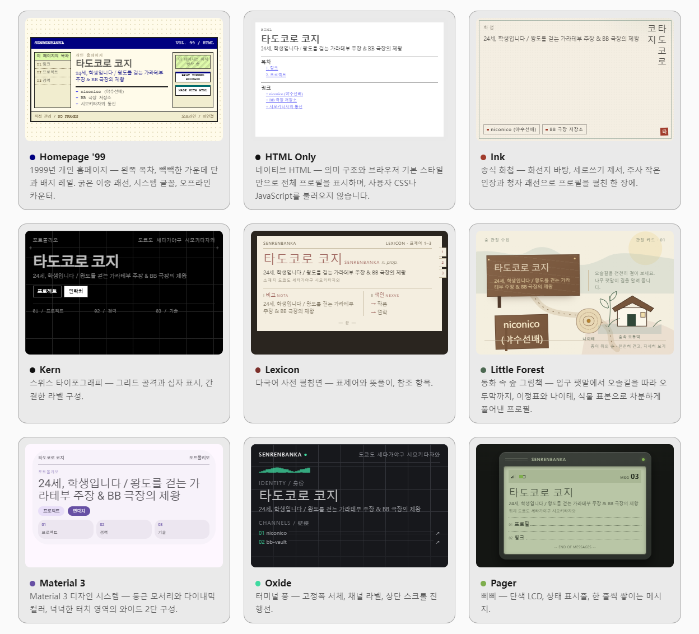
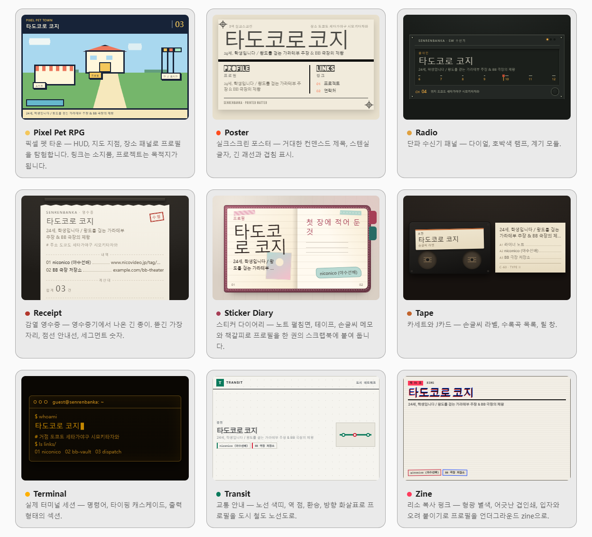

# SenrenBanka

[简体中文](../../README.md) | [繁體中文](README.zh-TW.md) | [日本語](README.ja.md) | [English](README.en.md) | 한국어

> SenrenBanka（「洗練万華」）：一つの**洗練**されたデータから、**万華**鏡のように千変万化するプロフィールサイトを映し出す。

하나의 프로필에서 AI가 `DESIGN.md`를 기반으로 생성한 여러 개의 완성된 디자인을 제공합니다. 중국어 간체 / 중국어 번체 / 일본어 / 영어 / 한국어를 지원하며, 빌드 시 완전한 정적 페이지를 생성해 어떤 정적 호스팅에도 배포할 수 있습니다.

기술 스택: Astro + TypeScript + Tailwind CSS 4

## 기능

- 시각적·구조적으로 서로 다른 27개 디자인(26개 `styled` + CSS / JS가 없는 HTML-only 1개)이 모두 동일한 프로필 계약을 공유합니다
- **다국어(현재 `zh-CN` / `zh-TW` / `ja` / `en` / `ko`)**: 각 디자인은 **지원을 선언한** 모든 언어에서 별도 정적 페이지가 됩니다. 프로필, 문구, SEO 메타데이터는 언어별로 분리되며, 지원하지 않는 locale에는 해당 디자인 페이지를 생성하지 않습니다
- **`styled` 페이지의 언어 전환과 페이지 작업 진입점 통합**: 데스크톱 컨텍스트 메뉴, 모바일 플로팅 버튼 → 하단 액션 시트가 동일한 데이터와 의미를 공유합니다(**데스크톱과 모바일 모두 사용 가능**). `html-only`는 네이티브 링크를 사용하며 이 메뉴를 연결하지 않습니다
- 랜덤 / 고정 두 가지 모드, 진입 시 랜덤 및 연속 중복 방지, 수동 전환 설정 가능
- 디자인별 독립 CSS(Tailwind `source(none)` + `@source` 정밀 격리), **다국어 지원으로도 이 점은 바뀌지 않습니다**. 폰트는 빌드 시 자체 호스팅되며 런타임에 제3자 요청이 없습니다
- 루트 경로는 외부 요청이 없는 클라이언트 라우팅입니다. 각 언어에서는 기본 디자인만 인덱싱할 수 있습니다(거의 중복되는 콘텐츠 방지)
- 이 저장소를 템플릿 또는 fork로 사용하고 프로필과 `src/data/site.config.yaml`만 수정하면 GitHub Pages / Cloudflare Pages / Vercel에 배포할 수 있습니다

## 모든 디자인

27개 디자인은 하나의 프로필을 공유합니다. 아래 각 이미지는 디자인 9개를 보여 줍니다. 배포 후 `/<locale>/designs/`에서 상호작용 가능한 전체 목록을 볼 수 있습니다.






## Agent 원클릭 배포

`personal-site-launch` skill 설치

```bash
npx skills add ShiroPrism/SenrenBanka --skill personal-site-launch -g
```

`-g`는 사용자 수준 skill 디렉터리에 설치한다는 뜻이며, 이후 어떤 프로젝트에서도 호출할 수 있습니다. 명령줄 안내에 따라 사용하는 Agent를 선택하세요. `-g`를 빼고 현재 프로젝트에만 설치할 수도 있습니다.

설치 후에는 수동으로 fork, clone, 저장소 생성할 필요가 없습니다. 아래 단축 Prompt로 `personal-site-launch`를 호출하고 개인 자료를 Agent에게 전달하세요:

```text
/personal-site-launch 템플릿 저장소 https://github.com/ShiroPrism/SenrenBanka에서 나만의 독립적인 개인 홈페이지 저장소를 만들고 로컬로 clone하세요. 그런 다음 제가 이어서 제공하는 이미지, PDF, DOCX, Markdown 등 개인 자료를 바탕으로 profiles를 생성하고 site.config.yaml을 동기화하며, 빌드 검증을 완료해 접근 가능한 URL로 배포하세요. 언어가 지정되지 않으면 자료의 언어와 프로젝트의 기존 언어에 따라 처리하세요. GitHub, Cloudflare 또는 Vercel 연결/권한이 없으면 제가 활성화해야 할 항목을 직접 나열하고 기다리며, 제가 저장소를 수동으로 처리하도록 요구하지 마세요.
```

기본적으로 GitHub Pages를 우선합니다. Cloudflare Pages Direct Upload 또는 Vercel CLI만 사용하려면 Prompt에 직접 명시하세요. 로컬에서 업로드하는 배포 방식은 먼저 GitHub 저장소를 만들 필요가 없습니다.

## 빠른 시작

```bash
npm ci
npm run fonts:prepare  # fonts.lock.json에 따라 .cache/fonts/와 .cache/font-sources/로 다운로드 및 검증
npm run dev            # http://localhost:4321
npm run build          # eol/lint/format + fonts:check + astro check + build + fonts:subset + fonts:prune + HTML 감사
npm run preview
```

코드와 설정은 Prettier + ESLint를 사용합니다. 파일을 추가하거나 수정한 뒤 `npm run format && npm run lint`를 실행하세요. 줄바꿈은 `.gitattributes` / `.editorconfig`에 의해 LF로 고정되며, `npm run check:eol`이 빌드 전에 CRLF를 차단합니다.

폰트 캐시는 버전 관리에 포함되지 않으며 `postinstall`에서 암묵적으로 네트워크에 연결하지 않습니다. 새로 clone한 경우 반드시 `npm run fonts:prepare`를 명시적으로 실행해야 합니다. 준비가 끝나면 `npm run build`의 `fonts:check`가 잠금, 스냅샷, 캐시 파일, 생성 레지스트리의 해시를 완전히 오프라인으로 다시 계산합니다. 캐시가 없거나 손상되면 복구 명령을 표시하고 실패합니다.

`--font-*` 변수는 기본 face만 노출하며, 6개 npm family와 31개 외부 local family에는 Astro fallback이 없습니다. 각 디자인의 `style.css`는 "라틴 음역 → 핵심 CJK(Zhuque / LXGW / Ark Pixel / 번체 중국어 TC 계열) → 시스템 중국어 글꼴 → 일반 계열"의 전체 순서를 직접 유지하며, `npm run fonts:typography`가 이 계약을 정적으로 검사합니다.

`fonts:prepare`는 핵심 CJK 글꼴의 source archive도 다운로드하고 검증합니다. 빌드 끝의 `fonts:subset`는 최종 `dist` 코퍼스에서 family별로 WOFF2 글리프 서브셋 하나를 생성하고, `fonts:prune`는 남은 `@font-face`를 공용 폰트 CSS로 외부화하고 참조되지 않는 샤드를 삭제합니다. `dist`의 모든 파일 바이트 총합 상한은 **10 MiB**입니다. 소스 폰트, 잠금, 스냅샷, 생성 레지스트리는 변경되지 않으며, fork 사용자는 `npm run fonts:prepare && npm run build`만 실행하면 되고 로컬 폰트, Python, 추가 서브셋 도구가 필요하지 않습니다.

최소 프로필에는 다음 네 가지 핵심 필드만 필요합니다. `src/data/profiles/zh-cn.yaml`을 직접 교체하세요(`ja.yaml` / `en.yaml`도 같은 방식):

```yaml
name: "당신의 이름"
headline: "한 문장 포지셔닝"
bio: "1~3문장 소개."
links:
  - label: GitHub
    url: "https://github.com/you"
```

- 프로필 변경: `src/data/profiles/*.yaml`(설정된 언어마다 하나, 현재 `zh-cn` / `zh-tw` / `ja` / `en` / `ko`; **모두 같은 고정 필드 계약 공유**; 핵심 필수: `name` / `headline` / `bio` / `links`)
- **fork 시 필수 변경: `src/data/site.config.yaml`**——profile만 교체하면 예시 인물의 사이트 제목 / 설명과 언어 목록이 남습니다:
  - `i18n.locales[].title` / `description`: 해당 언어의 SEO 제목과 설명;
  - `i18n.locales[].notice`: 예시 데이터 고지; 실제 자료를 넣은 뒤 이 키를 삭제;
  - `i18n.locales`: 언어 목록은 여기서만 관리합니다. 언어 추가/삭제 = 이 목록 변경 + 해당 `profiles/<path>.yaml` 추가/삭제; `defaultLocale`은 목록에 있어야 합니다
- 일반 선택 필드: `avatar`(일부 스타일은 사진을 표시하지 않음) / `location`
- 고급 선택 확장 블록: `projects` / `experience` / `skills` / `contact`. 기존 디자인과의 호환성을 위해서만 유지되며 전체 생략할 수 있습니다. 사용자 지정 콘텐츠 메커니즘이 아니며 같은 종류의 필드나 블록을 더 확장하지도 않습니다
- 외부 콘텐츠: `links`로 포트폴리오, 글, 소셜 프로필 등 더 많은 정보를 안내합니다. 사이트를 떠난 콘텐츠의 가용성, 접근성, 소유권, 지속성은 외부 플랫폼이 관리합니다
- 저장소의 전체 Profile(현재 5개)은 여러 디자인의 콘텐츠 표현을 검증하기 위한 디자인 샘플이며 필수 템플릿이 아닙니다
- 언어 변경: `src/data/site.config.yaml`의 `i18n.locales`(**언어 목록은 이 한 곳에서만 관리**: 언어 추가/삭제 = `locales` 항목 하나 + 같은 이름의 `profiles/<path>.yaml` 하나 추가/삭제). 언어를 추가하려면 해당 언어를 지원할 각 디자인의 `design.json` `locales`에도 해당 code를 추가해야 합니다. 기본 디자인은 모든 locale을 지원해야 합니다. **한 가지 언어만 유지**: `i18n.locales`를 1개로 줄이고 불필요한 profiles를 삭제하세요. `design.json`에 없는 code는 무시되며, 언어 그룹과 네이티브 언어 영역은 통째로 렌더링되지 않습니다(`/<locale>/` 접두사는 유지)
- 패키징 범위: `src/data/site.config.yaml`의 `design.exclude`(기본 `[]` = 모든 디자인; 제외된 디자인은 페이지/이전 리디렉션을 빌드하지 않고 랜덤 풀과 전환 페이지에도 들어가지 않습니다. `enabled`는 패키징 집합 안에서만 유효). 예: `exclude: [archive]`
- 동작 변경: `src/data/site.config.yaml`의 `design`(`mode` / `default` / `manualSwitch` / `exclude` / `cacheHours`)
- 인터페이스 문구 변경: 공용 문구는 `src/i18n/messages.ts`, 각 디자인 고유 문구는 `src/designs/<id>/messages.ts`(파일 또는 키 누락은 **빌드 시 오류**)
- 디자인 추가/삭제: `src/designs/<id>/` 아래 디렉터리를 만들거나 삭제하면 됩니다(디렉터리가 존재하면 등록됨). `DESIGN.md` / `design.json` / `Page.astro` / `messages.ts`를 함께 제공해야 합니다. `renderMode: "styled"`(기본)는 `style.css`가 추가로 필요하고, `renderMode: "html-only"`는 `style.css` / `tokens.css`를 금지하지만 자체 완결형 `Preview.astro`는 제공할 수 있습니다. 절차와 준수 요구 사항은 `SPEC.md` §4–§6과 `docs/rules/`를 참고하세요. 디렉터리를 추가한 뒤 `npm run dev`를 다시 시작해야 합니다.
- 폰트: 수동 선택은 `fonts.config.json`에서만 관리합니다. `fonts.lock.json` / `fonts.catalog.json` / `src/fonts/generated.ts`는 `npm run fonts:update`가 고정된 외부 카탈로그 릴리스물에서 생성합니다. 6개 Fontsource family도 설정 내 래퍼 계층을 통해 설치된 `node_modules` 파일을 읽으며 빌드 시 CDN에 의존하지 않습니다. 생성 파일을 직접 수정하지 말고 `.cache/fonts/` 또는 `.cache/font-sources/`를 커밋하지 마세요. `npm run fonts:subset`의 서브셋 보고서는 `.cache/fonts/subset-report.json`, `npm run fonts:prune`의 배포 샤드 집합과 크기 보고서는 `.cache/fonts/prune-report.json`, `npm run fonts:audit`의 핵심 CJK 누락 글자 및 배포 집합 보고서는 `.cache/fonts/audit-report.json`에 기록됩니다.

폰트 카탈로그를 업그레이드할 때는 릴리스 페이지의 고정 URL과 SHA를 명시적으로 제공해야 하며, "자동으로 최신을 추적"하는 방식은 허용하지 않습니다:

```bash
npm run fonts:update -- \
  --catalog-url https://github.com/whitehair-failure/SenrenBanka-fonts/releases/download/catalog-v1.0.0/catalog.json \
  --catalog-sha256 <release-sha256>
npm run fonts:prepare
npm run fonts:check
```

### URL 규칙

```
/                         루트 진입점 → 언어 협상(설정 → 브라우저 언어 → 기본 zh-CN) 후 랜덤 / 고정 디자인으로 진입
/zh-cn/<design>/  /zh-tw/<design>/  /ja/<design>/  /en/<design>/  /ko/<design>/    각 언어에서 선언된 디자인 페이지(유일한 공식 주소)
/zh-cn/designs/ 등        각 언어의 테마 전환 페이지(manualSwitch가 꺼져 있으면 빌드하지 않음)
/<design>/  /designs/     접두사 없는 이전 경로 → 기본 언어 버전으로 정적 리디렉션(meta refresh + canonical + noindex)
```

- `/`는 "수동 언어 설정 → 브라우저 언어 → `i18n.defaultLocale`" 순서로 Locale을 협상합니다. `/<locale>/...`의 경로 언어가 항상 우선하며, 런타임 재작성이나 Cookie 기반 언어 감지를 사용하지 않습니다.
- 전체 사이트에는 `404.html`이 하나뿐입니다. 런타임에 "요청 경로 첫 세그먼트 → 언어 설정 → 브라우저 언어 → 기본 Locale" 순서로 표시 언어를 해석하고, 각 언어 블록을 미리 렌더링해 첫 화면 전에 전환합니다. JavaScript가 없으면 기본 Locale을 고정 표시합니다. 언어별로 별도 404 페이지를 생성하지 않습니다.
- 현재 배포는 진입 랜덤(`cacheHours: 0`)을 사용합니다. `/` 또는 `/<locale>/`에 들어갈 때마다 디자인을 다시 추첨합니다. `/<locale>/<design>/`은 안정적인 디자인 주소이며, 직접 방문·새로 고침·북마크·공유에서는 다시 추첨하지 않습니다. "매번 다른 디자인"을 북마크하려면 `/` 또는 `/<locale>/`을 북마크하세요.
- JavaScript가 없어도 `/`는 `meta refresh`로 기본 Locale의 기본 디자인과 디자인 목록으로 이동합니다. 브라우저 언어 협상은 사용할 수 없으며, 이는 이 폴백 경로의 알려진 제한입니다.
- 하위 경로(GitHub Pages의 `/<repo>/` 등)에 배포하면 모든 링크, CSS, 폰트, `canonical`, `hreflang`에 base 접두사가 자동으로 붙습니다.
- 이전 경로는 **진짜 HTTP 301이 아닙니다**(정적 호스팅 제한). 명시적으로 선언된 폴백으로, 정적 meta refresh + `canonical` + `noindex, follow`입니다. 진짜 301이 필요하면 호스팅 플랫폼 쪽에서 설정하세요.

### 언어 전환

`styled` 페이지의 언어 전환 진입점은 **공용 작업 메뉴** 안의 그룹입니다. `html-only` 페이지는 본문 내비게이션에 일반 언어 링크를 직접 나열합니다. 두 모드 모두 언어를 전환할 때 **현재 페이지 맥락을 유지**합니다 — 테마 페이지에서는 현재 디자인을 유지하고, 전환 페이지에서는 전환 페이지를 유지하며, 404에서는 해당 언어의 진입점으로 돌아갑니다.

- 데스크톱 마우스 환경: 우클릭 또는 `Shift+F10`으로 메뉴를 열며, 언어 항목은 하위 메뉴에 모여 있습니다.
- 모바일: 오른쪽 아래 **플로팅 버튼**으로 **하단 액션 시트**를 열며, 언어 항목이 바로 펼쳐집니다(터치에는 hover 하위 메뉴의 멘탈 모델이 없습니다).
- 위 두 항목은 `styled` 페이지에 적용됩니다. `html-only`의 일반 언어 링크는 입력 환경의 영향을 받지 않습니다.
- 테마 설정(`localStorage`)은 언어 간 공유됩니다. `styled` 페이지에서 언어를 전환해도 디자인 저장소는 **초기화되지 않습니다**. 현재 제로 윈도 랜덤에서는 다음에 진입점에서 들어올 때 다시 추첨됩니다.
- 공용 작업 메뉴에서 언어 링크를 명시적으로 클릭하면 진입 언어 설정이 기억됩니다. 특정 언어의 디자인 페이지를 직접 열어도 기존 설정을 덮어쓰지 않습니다. `html-only` 페이지는 런타임이 없으므로 언어 클릭은 이번 탐색만 완료하고 설정을 저장하지 않습니다.
- 404의 표시 언어는 언어 설정만 읽으며, 잘못된 경로 때문에 자동으로 기록되지 않습니다. 공용 메뉴의 현재 언어 표시, 문구, 랜덤 대상은 404 표시 언어를 따릅니다.
- JavaScript가 없으면 `styled` 디자인 페이지의 언어 진입점에 도달할 수 없습니다(공용 메뉴가 런타임에 의존). 전환 페이지와 404는 `<noscript>` 언어 링크로 폴백하며, `html-only` 디자인 페이지는 항상 표시되는 네이티브 언어 링크를 사용합니다.

### 페이지 작업

`styled` 페이지의 같은 메뉴는 새로 고침, 맨 위로, 링크 복사, 인쇄 / PDF 저장, 페이지 공유, 랜덤 테마 전환도 제공합니다. `html-only` 페이지는 이러한 메뉴 작업을 제공하지 않고 일반 링크 내비게이션만 유지합니다.

- 테마 페이지의 "랜덤 디자인"은 현재 디자인을 제외합니다. 전환 페이지와 404에는 "현재 디자인"이 없으므로 모든 테마에서 선택합니다.
- 메뉴 스타일은 프로젝트 chrome에 속하며 중립적인 외관으로 어떤 테마의 시각 언어도 모방하지 않습니다(`docs/rules/action-menu.md` 및 ADR 0007 참고).

## 배포

### GitHub Pages(template / fork 제로 설정)

1. 저장소 Settings → Pages → Source에서 **GitHub Actions** 선택
2. `main`에 push하면 자동으로 빌드 및 배포됩니다. 워크플로는 `fonts.lock.json` 해시로 `.cache/fonts/`를 재사용한 뒤 `npm run fonts:prepare`를 실행합니다. `SITE_URL` / `BASE_PATH`는 저장소 컨텍스트에서 자동으로 주입됩니다
3. 사용자 지정 도메인: 워크플로에서 `BASE_PATH`를 `/`로 바꾸고 `public/`에 `CNAME` 파일을 둡니다

### Cloudflare Pages

- 저장소를 연결; Build command `npm ci && npm run fonts:prepare && npm run build`; Build output directory `dist`
- 선택 환경 변수: `SITE_URL=https://<your-domain>`(canonical 절대 주소에 사용)
- 빌드 환경은 Node.js 24를 사용합니다(프로젝트 `.nvmrc`). 캐시가 없을 때는 `fonts:prepare`만 네트워크에 접속하며, 이후 build는 폰트 소스에 접근하지 않습니다.

### Vercel

- 저장소를 가져오면 프레임워크 프리셋이 Astro를 자동으로 인식합니다. Install Command `npm ci`; Build Command `npm run fonts:prepare && npm run build`; 선택 환경 변수 `SITE_URL`
- Node.js 버전 24를 사용합니다(프로젝트 `.nvmrc`). 20개 local-provider family의 바이너리는 Git에 포함되지 않으며 배포 시 고정된 폰트 카탈로그 Release에서 준비합니다.

## 디자인 출처 및 라이선스

- 이 저장소의 코드: MIT(`LICENSE` 참고)
- Oxide 디자인 사양: [oxidecomputer/design-system](https://github.com/oxidecomputer/design-system)에서 가져옴(MPL-2.0)
- Material 3 디자인 사양: [m3.material.io](https://m3.material.io/) 및 [material-components/material-web](https://github.com/material-components/material-web)에서 가져옴(CC BY 4.0 / Apache-2.0)
- 각 공식 출처의 전체 라이선스와 저작자 표시는 해당 디자인 디렉터리의 `SOURCE-LICENSE.txt`에 있습니다. 출처 URL, 가져온 날짜, 라이선스는 `design.json`에 있습니다

## 문서

- `docs/README.md`: 문서 책임 인덱스와 유지 관리 규칙(문서를 변경하기 전에 먼저 읽기)
- `SPEC.md`: 프로젝트 사양과 사실의 원천(결정 기록, 런타임 규칙, 디렉터리 구조, 인수 기준)
- `AGENTS.md`: 코딩 Agent 규칙 진입점(하드 게이트 + 작업 라우팅; 전체 본문은 `docs/rules/`; 검증 흐름은 `design-page-verify` skill)
- `docs/adr/` 장기 기술 결정 · `docs/designs/<id>/ADAPTATION.md` 테마 적응 기록 · `docs/verification/` 각 테마와 공용 메커니즘의 현재 검증 상태 · `change-log/` 버전 기록
