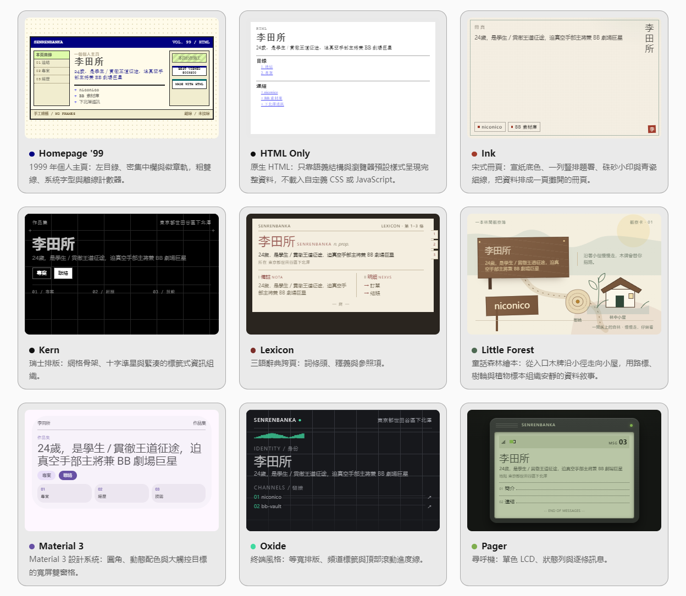

# SenrenBanka

[简体中文](../../README.md) | 繁體中文 | [日本語](README.ja.md) | [English](README.en.md) | [한국어](README.ko.md)

> SenrenBanka（「洗練万華」）：一つの**洗練**されたデータから、**万華**鏡のように千変万化するプロフィールサイトを映し出す。

一份個人資料，多套由 AI 依據 `DESIGN.md` 生成的完整設計，支援簡中 / 繁中 / 日 / 英 / 韓五語言——建置期產出純靜態頁面，可部署到任何靜態託管。

技術堆疊：Astro + TypeScript + Tailwind CSS 4

## 特色

- 27 套視覺與結構互異的設計（26 套 `styled` + 1 套零 CSS / JS 的 HTML-only），共用同一份資料契約
- **多語言（目前 `zh-CN` / `zh-TW` / `ja` / `en` / `ko`）**：每套設計在每種**它宣告涵蓋**的語言下都是獨立靜態頁，資料、文案與 SEO 中繼資料依語言分離；未涵蓋的 locale 不生成該設計頁面
- **`styled` 頁面的語言切換與頁面操作入口統一**：桌面右鍵選單、行動端懸浮球 → 底部動作面板，資料與語意完全共用（**桌面與行動端皆可用**）；`html-only` 使用原生連結，不接入該選單
- 隨機 / 固定兩種模式、入口隨機與避免連續重複、可設定手動切換
- 每套設計獨立 CSS（Tailwind `source(none)` + `@source` 精確隔離），**多語言不改變此點**，字型於建置期自託管，執行時零第三方請求
- 根路徑是零外部請求的用戶端路由；每種語言僅其預設設計對外可索引（避免近重複內容）
- 使用本儲存庫作為範本或 fork 後，只需改資料與 `src/data/site.config.yaml` 即可部署 GitHub Pages / Cloudflare Pages / Vercel

## 全部設計

27 套設計共用同一份資料，下面每張圖展示 9 套。部署後可在 `/<locale>/designs/` 查看可互動的完整列表。





## Agent 一鍵部署

安裝 `personal-site-launch` skill

```bash
npx skills add ShiroPrism/SenrenBanka --skill personal-site-launch -g
```

`-g` 表示安裝到使用者級 skill 目錄，之後可以在任意專案中呼叫；依命令列提示選擇你使用的 Agent。也可以去掉 `-g`，只安裝到目前專案。

安裝後不需要手動 fork、clone 或建立儲存庫。把下面的快捷 Prompt 呼叫 `personal-site-launch` 並把你的個人資料交給 Agent：

```text
/personal-site-launch 請從範本儲存庫 https://github.com/ShiroPrism/SenrenBanka 建立一個屬於我的獨立個人主頁儲存庫並複製到本機，然後根據我接下來提供的圖片、PDF、DOCX、Markdown 等個人資料生成 profiles、同步 site.config.yaml，完成建置驗證並部署為可存取網址。未指定語言時，依資料語言與專案現有語言處理；缺少 GitHub、Cloudflare 或 Vercel 連線/權限時，直接列出需要我開啟的項目並等待，不要讓我手動處理儲存庫。
```

預設優先 GitHub Pages。如果你只想用 Cloudflare Pages Direct Upload 或 Vercel CLI，在 Prompt 裡直接說明即可；那類從本機上傳的部署方式不需要先建立 GitHub 儲存庫。

## 快速開始

```bash
npm ci
npm run fonts:prepare  # 依 fonts.lock.json 下載並驗證到 .cache/fonts/ 與 .cache/font-sources/
npm run dev            # http://localhost:4321
npm run build          # eol/lint/format + fonts:check + astro check + build + fonts:subset + fonts:prune + HTML 稽核
npm run preview
```

程式碼與設定統一使用 Prettier + ESLint；新增或修改檔案後執行 `npm run format && npm run lint`。行尾由 `.gitattributes` / `.editorconfig` 固定為 LF，`npm run check:eol` 會在建置前攔截 CRLF。

字型快取不進入版本控制，也不在 `postinstall` 中隱式連網。乾淨 clone 必須先明確執行 `npm run fonts:prepare`；準備完成後，`npm run build` 的 `fonts:check` 會完全離線重算鎖、快照、快取檔案與生成註冊的雜湊。快取缺失或損壞時會給出修復命令並失敗。

`--font-*` 變數只暴露主 face；6 個 npm family 與 31 個外部 local family 都不攜帶 Astro fallback。每套設計的 `style.css` 自行維護「拉丁聲部 → 核心 CJK（Zhuque / LXGW / Ark Pixel / 繁中 TC 族）→ 系統中文字型 → 通用族」的完整順序，`npm run fonts:typography` 會靜態檢查這條契約。

`fonts:prepare` 也會為核心 CJK 字型下載並驗證 source archive；建置末尾的 `fonts:subset` 依最終 `dist` 語料生成每族一個 WOFF2 字形子集，`fonts:prune` 再把剩餘 `@font-face` 外置為共用字型 CSS 並刪除未引用分片。`dist` 全部檔案位元組上限為 **10 MiB**。來源字型、鎖、快照與生成註冊不變；fork 使用者只需執行 `npm run fonts:prepare && npm run build`，不需要本機字型、Python 或額外子集化工具。

最小資料只需以下四個核心欄位，可直接替換 `src/data/profiles/zh-cn.yaml`（`ja.yaml` / `en.yaml` 同理）：

```yaml
name: "你的名字"
headline: "一句話定位"
bio: "1–3 句簡介。"
links:
  - label: GitHub
    url: "https://github.com/you"
```

- 改資料：`src/data/profiles/*.yaml`（每種設定語言一份，目前 `zh-cn` / `zh-tw` / `ja` / `en` / `ko`；**共用同一套固定欄位契約**；核心必填：`name` / `headline` / `bio` / `links`）
- **fork 必改：`src/data/site.config.yaml`**——只替換 profile 會保留範例人物的站點標題 / 描述與語言清單：
  - `i18n.locales[].title` / `description`：該語言的 SEO 標題與描述；
  - `i18n.locales[].notice`：範例資料聲明；填入真實資料後刪除該鍵；
  - `i18n.locales`：語言清單只在這裡維護；增刪語言 = 改這裡 + 增刪對應的 `profiles/<path>.yaml`；`defaultLocale` 必須在清單中
- 一般可選欄位：`avatar`（部分風格不放照片）/ `location`
- 進階可選擴充區塊：`projects` / `experience` / `skills` / `contact`。它們僅為相容現有設計而保留，可整體省略；不是自訂內容機制，也不會繼續擴充同類欄位或區塊
- 站外內容：透過 `links` 指向作品集、文章或社群資料等更多資訊；內容離開本站後，其可用性、無障礙性、歸屬與持久性由外部平台控制
- 儲存庫中的完整 Profile（目前五份）是用於驗證多套設計內容呈現的設計樣張，不是必填範本
- 改語言：`src/data/site.config.yaml` 的 `i18n.locales`（**語言清單只在這裡維護一處**：增刪語言 = 加一份 `locales` 條目 + 一份同名 `profiles/<path>.yaml`）。新增語言還要在要涵蓋它的設計 `design.json` 的 `locales` 中追加該 code；預設設計必須涵蓋全部 locale。**只保留一種語言**：把 `i18n.locales` 改為 1 條並刪除多餘 profiles；`design.json` 中未設定的 code 會被忽略，語言群組與原生語言區整組不渲染（保留 `/<locale>/` 前綴）
- 打包範圍：`src/data/site.config.yaml` 的 `design.exclude`（預設 `[]` = 全部設計；被排除的設計不建置頁面/舊跳轉，也不進入隨機池與切換頁；`enabled` 只在打包集合內生效）。範例：`exclude: [archive]`
- 改行為：`src/data/site.config.yaml` 的 `design`（`mode` / `default` / `manualSwitch` / `exclude` / `cacheHours`）
- 改介面文案：共用文案在 `src/i18n/messages.ts`，每套設計自己的文案在 `src/designs/<id>/messages.ts`（缺檔案或缺鍵**建置期報錯**）
- 增刪設計：在 `src/designs/<id>/` 新增或刪除目錄即可（目錄存在即註冊）。必須共同提供 `DESIGN.md` / `design.json` / `Page.astro` / `messages.ts`；`renderMode: "styled"`（預設）另需 `style.css`，`renderMode: "html-only"` 則禁止 `style.css` / `tokens.css`，但可提供自包含的 `Preview.astro`。流程與合規需求見 `SPEC.md` §4–§6 與 `docs/rules/`。新增目錄後需重新啟動 `npm run dev`。
- 字型：人工選擇只維護 `fonts.config.json`；`fonts.lock.json` / `fonts.catalog.json` / `src/fonts/generated.ts` 由 `npm run fonts:update` 從固定外部目錄發行物生成。6 個 Fontsource family 也透過設定內包裝層讀取已安裝的 `node_modules` 檔案，不依賴建置期 CDN。不要手改生成檔案，也不要提交 `.cache/fonts/` 或 `.cache/font-sources/`。`npm run fonts:subset` 的子集報告寫到 `.cache/fonts/subset-report.json`，`npm run fonts:prune` 的部署分片集與體積報告寫到 `.cache/fonts/prune-report.json`；`npm run fonts:audit` 會把核心 CJK 缺字與部署集合報告寫到 `.cache/fonts/audit-report.json`。

升級字型目錄時必須明確提供發佈頁中的固定 URL 與 SHA，不接受「自動追最新」：

```bash
npm run fonts:update -- \
  --catalog-url https://github.com/whitehair-failure/SenrenBanka-fonts/releases/download/catalog-v1.0.0/catalog.json \
  --catalog-sha256 <release-sha256>
npm run fonts:prepare
npm run fonts:check
```

### URL 規則

```
/                         根入口 → 協商語言（偏好 → 瀏覽器語言 → 預設 zh-CN），再進入隨機 / 固定設計
/zh-cn/<設計>/  /zh-tw/<設計>/  /ja/<設計>/  /en/<設計>/  /ko/<設計>/    各語言下已宣告涵蓋的設計頁（唯一權威位址）
/zh-cn/designs/ 等          各語言的主題切換頁（manualSwitch 關閉時不建置）
/<設計>/  /designs/         舊無前綴路徑 → 預設語言版本的靜態跳轉（meta refresh + canonical + noindex）
```

- `/` 依「手動語言偏好 → 瀏覽器語言 → `i18n.defaultLocale`」協商 Locale；`/<locale>/...` 的路徑語言始終優先，不做執行時改寫，也不使用 Cookie 語言偵測。
- 全站只有一份 `404.html`：執行時依「請求路徑首段 → 語言偏好 → 瀏覽器語言 → 預設 Locale」解析展示語言，預渲染各語言區塊並在首屏前切換；無 JavaScript 時固定顯示預設 Locale。不會為每種語言生成獨立 404 頁面。
- 目前部署使用入口隨機（`cacheHours: 0`）：每次從 `/` 或 `/<locale>/` 進入都重新抽取設計；`/<locale>/<design>/` 是穩定設計位址，直達、重新整理、書籤與分享都不會重抽。想書籤「每次換一套」，請書籤 `/` 或 `/<locale>/`。
- 無 JavaScript 時 `/` 仍以 `meta refresh` 進入預設 Locale 的預設設計與設計列表；瀏覽器語言協商不可用，這是該降級路徑的已知限制。
- 部署到子路徑（如 GitHub Pages 的 `/<repo>/`）時，所有連結、CSS、字型、`canonical` 與 `hreflang` 自動帶上 base 前綴。
- 舊路徑**不是**真正的 HTTP 301（靜態託管限制），而是明確宣告的降級：靜態 meta refresh + `canonical` + `noindex, follow`。如需真 301，請在託管平台側設定。

### 語言切換

`styled` 頁面的語言切換入口是**共用操作選單**裡的一個群組；`html-only` 頁面在正文導覽中直接列出普通語言連結。兩種模式切換語言都會**保持目前頁面脈絡**——在主題頁保持目前設計，在切換頁保持切換頁，在 404 回到對應語言的入口。

- 桌面滑鼠環境：右鍵或 `Shift+F10` 開啟選單，語言項目收在二級子選單裡。
- 行動端：右下角**懸浮球**開啟**底部動作面板**，語言項目直接平鋪（觸屏沒有 hover 二級選單的心智模型）。
- 以上兩條適用於 `styled` 頁面；`html-only` 的普通語言連結不受輸入環境影響。
- 主題偏好（`localStorage`）跨語言共用：在 `styled` 頁面切換語言**不會**重設設計儲存；目前零視窗隨機下，下一次從入口進入仍會重抽。
- 在共用操作選單中明確點擊語言連結會記住入口語言偏好；直接開啟某個語言的設計頁不會覆蓋既有偏好。`html-only` 頁面沒有執行時，語言點擊只完成本次導覽，不持久化偏好。
- 404 的展示語言只讀取語言偏好，不因錯誤路徑自動寫入；共用選單的目前語言標記、文案與隨機目標會跟隨 404 展示語言。
- 無 JavaScript 時，`styled` 設計頁的語言入口不可達（共用選單依賴執行時）；切換頁與 404 由 `<noscript>` 語言連結回退，`html-only` 設計頁使用始終可見的原生語言連結。

### 頁面操作

`styled` 頁面的同一套選單還提供重新載入、回到頂端、複製連結、列印 / 儲存為 PDF、分享頁面，以及隨機切換主題。`html-only` 頁面不提供這些選單動作，只保留普通連結導覽。

- 主題頁的「隨機一個設計」會排除目前設計；切換頁與 404 沒有「目前設計」，走全部主題。
- 選單樣式屬專案 chrome，中性外觀，不模仿任何一套主題的視覺語言（見 `docs/rules/action-menu.md` 與 ADR 0007）。

## 部署

### GitHub Pages（template / fork 零設定）

1. 儲存庫 Settings → Pages → Source 選擇 **GitHub Actions**
2. push 到 `main` 即自動建置部署；工作流程依 `fonts.lock.json` 雜湊重用 `.cache/fonts/`，隨後執行 `npm run fonts:prepare`；`SITE_URL` / `BASE_PATH` 從儲存庫脈絡自動注入
3. 自訂網域：把工作流程中 `BASE_PATH` 改為 `/`，並在 `public/` 放置 `CNAME` 檔案

### Cloudflare Pages

- 連接儲存庫；Build command `npm ci && npm run fonts:prepare && npm run build`；Build output directory `dist`
- 可選環境變數：`SITE_URL=https://<你的網域>`（用於 canonical 絕對位址）
- 建置環境使用 Node.js 24（專案 `.nvmrc`）；只有 `fonts:prepare` 在有快取缺失時連網，之後的 build 不存取字型來源。

### Vercel

- 匯入儲存庫，框架預設自動辨識 Astro；Install Command `npm ci`；Build Command `npm run fonts:prepare && npm run build`；可選環境變數 `SITE_URL`
- Node.js 版本使用 24（專案 `.nvmrc`）；20 個 local-provider family 的二進位不進入 Git，部署時由固定的字型目錄 Release 準備。

## 設計來源與授權

- 本儲存庫程式碼：MIT（見 `LICENSE`）
- Oxide 設計規範：來自 [oxidecomputer/design-system](https://github.com/oxidecomputer/design-system)（MPL-2.0）
- Material 3 設計規範：來自 [m3.material.io](https://m3.material.io/) 與 [material-components/material-web](https://github.com/material-components/material-web)（CC BY 4.0 / Apache-2.0）
- 每套官方來源的完整授權與署名見對應設計目錄下的 `SOURCE-LICENSE.txt`；來源 URL、取得日期與授權見 `design.json`

## 文件

- `docs/README.md`：文件職責索引與維護規則（改文件前先看它）
- `SPEC.md`：專案規格與事實來源（決策記錄、執行時規則、目錄結構、驗收標準）
- `AGENTS.md`：編碼 Agent 的規則入口（硬門禁 + 任務路由；完整正文在 `docs/rules/`；驗證流程見 `design-page-verify` skill）
- `docs/adr/` 長期技術決策 · `docs/designs/<id>/ADAPTATION.md` 主題適配記錄 · `docs/verification/` 各主題與共用機制的目前驗證狀態 · `change-log/` 版本記錄
